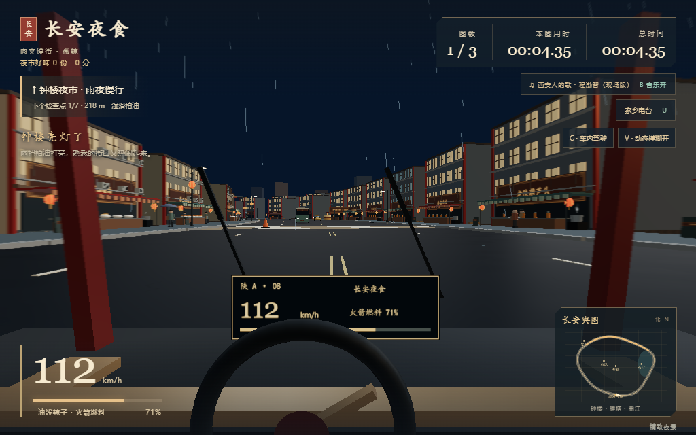
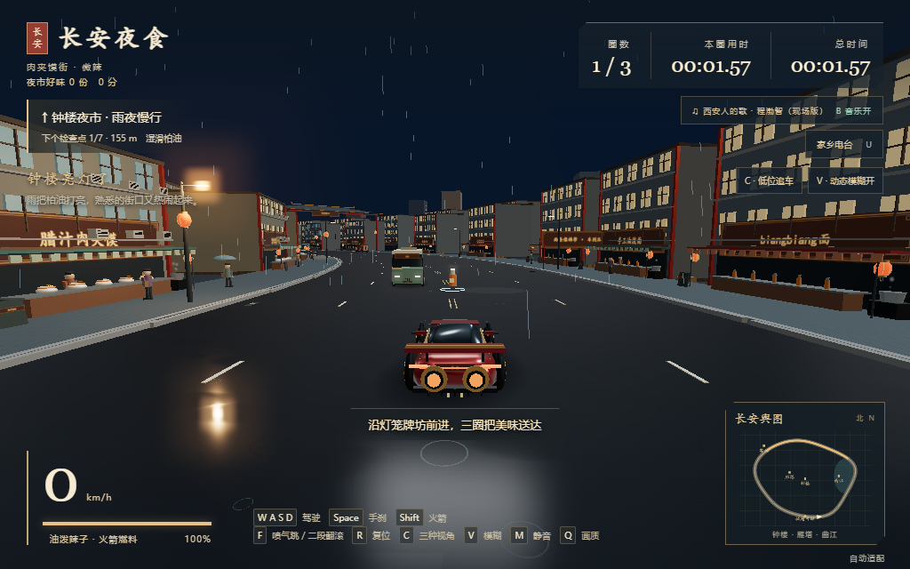
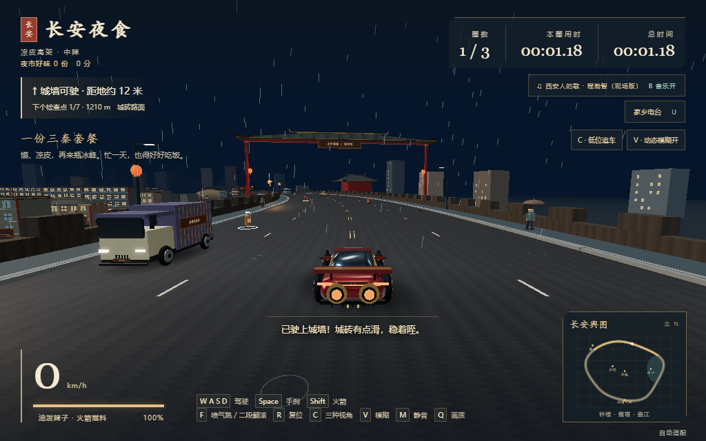

# 长安夜食

雨落南门，咥碗热的。开过钟楼、小寨与城墙，把惦记了一天的好味送到家。

**[在线游玩](https://vashzwingli.github.io/xian-food-racer/)** · [GitHub 仓库](https://github.com/vashzwingli/xian-food-racer)

入场以描金城楼、红灯笼、城门和三秦美食印章迎你回长安。进度对应引擎、街巷和首帧准备；准备好后开门进入菜单。点击“跳过入场”或按空格可跳过演出，场景仍会完成加载；菜单右上可重看，不重建城市。系统偏好减少动态效果时缩短入场并停用装饰动画，加载失败提供重试。


西安雨夜美食赛车：26 米宽街道、215 / 616 公交、夜市摊位、撑伞街坊、城墙驾驶、四点喷气、二段翻滚与食物拾取。三种辣度，每条赛道三圈。场景为游戏化创作，不对应真实可驾车的城墙或精确公交线路。

新增渐进转向、速度相关转向幅度、湿地侧滑与手刹回抓；S 先刹车，停稳后短暂缓冲再倒车。火箭结束自然减速，前轮转向与车身俯仰跟随驾驶。**C** 循环低位追车 / 高位巡游 / 车内驾驶；车内有实体仪表、方向盘与雨刷，翻滚时保留稳定视野。

**V** 开关随速度增强的动态模糊，路边有速度感，中央视野、仪表和文字保持清晰。静止、暂停及流畅画质自动停用，系统偏好减少动态效果时默认关闭。触屏可点画面中的视角/模糊按钮。





## 直接运行

- **推荐：双击 `index.offline.html`**。Three.js 与游戏代码均在这一个文件内，断网可运行，无须安装。
- `index.html` 是较小的 CDN 版，需要联网加载固定版本的 Three.js。
- 支持 WebGL2 的 Edge / Chrome 可游玩。电脑用键盘，触屏提供方向、油门、刹车、火箭及喷气翻滚按钮，建议横屏。
- 如果本地页面不能保存音乐，用下方本地服务打开，可在同一地址恢复上次导入的歌。

```sh
npm ci
npm run dev
```

然后打开 `http://127.0.0.1:5173`。游戏没有服务器账号、密钥或收费接口。

## 家乡电台与《西安人的歌》

默认内置 **《西安人的歌》程渤智现场版**（《十三亿分贝 第一期》，约 3 分 9 秒），点击发车或电台试听后循环播放。两种单文件版本都包含音频，无须连接音乐平台；B 开关音乐，M 总静音。

点击“家乡电台”或按 **U**，可切换内置歌曲、原创合成配乐《长安夜行》和自行导入的音频，调节音量。导入文件只保存在当前浏览器，**不会上传**；换浏览器、换地址或清理数据后需重新导入。删除导入文件会恢复内置歌曲。

歌曲来源为[网易云音乐公开播放版本](https://music.163.com/song?id=420125990)，不是约 3 分 54 秒的录音室版。项目所有者表示已申请使用并要求收录；本仓库不授予第三方音乐的再使用权。版本、来源和文件校验见 [音乐说明](assets/audio/SOURCE.md)。未收录歌词文本。

## 操作

| 按键 | 功能 |
| --- | --- |
| WASD / 方向键 | 油门、刹车、转向 |
| Space | 手刹 |
| Shift | 火箭推进 |
| F | 喷气起跳；长按延长滞空；空中再按二段翻滚 |
| A + 第二次 F | 反向翻滚 |
| R / C | 回检查点 / 循环低位追车、高位巡游、车内驾驶 |
| V | 开关动态模糊（高速时生效） |
| B / M / U | 音乐开关 / 总静音 / 家乡电台 |
| Q | 自动适配 → 流畅优先 → 精致夜景 |
| Esc | 暂停 / 继续 |

顺序通过七个检查点，再过起点计圈。施工段靠右慢行。沿主路坡道即可驶上约 12 米高的城墙。靠近拾取物自动收集：肉夹馍加积分，冰峰补充 22 燃料，辣子罐提供 8 秒加速。每圈恢复拾取物。

## 技术与性能

使用 **Three.js 0.170.0 + 原生 ES Modules + esbuild**。维护源码与交付文件分开：编辑 `src/`，构建后仍只需交付一个 HTML。没有 UI 框架或运行时打包器。

- 60 Hz 固定步长驾驶，使 30 / 60 / 144 Hz 屏幕使用相同规则；高速移动继续细分碰撞步长。
- 道路空间索引替代遍历全部路段；保留有向车身碰撞、实体避障和镜头避障。
- 静态街区按空间和材质合并；交通车轮实例绘制；合并车身与行人零件，保留轮胎、腿部、喷气和翻滚。
- 招牌、几何复用，重开时释放临时几何、实例缓冲和材质。
- 自动画质按持续帧耗时调整分辨率、Bloom、雨量与人物距离，软件渲染先以流畅档起步；持续极低帧率也会触发降档。延迟恢复避免频繁跳档，Q 可手动选择流畅或精致。
- HUD / 小地图限频更新；行人降低更新频率；后台暂停绘制和音频，失去焦点暂停驾驶。
- 原创街头记忆随路段切换：小寨晚班车、三秦套餐、南门灯火和回家吃饭。

性能取决于设备和浏览器，没有宣称所有设备恒定 60 FPS。结构见 [docs/ARCHITECTURE.md](docs/ARCHITECTURE.md)。

## 开发与验证

需要 Node.js 22 或更高版本。

```sh
npm ci
npm run build
npm run build:offline
npm test
npm run test:browser
npm run test:regression
npm run test:intro
```

Windows 测试默认使用 Edge；其他系统使用 Playwright Chromium，首次执行 `npx playwright install --with-deps chromium`。可用 `FOOD_RACER_BROWSER` 指定浏览器通道。

验证覆盖：

- 三种辣度各三圈实际驾驶物理、交通与检查点，零复位；这是自动驾驶验收，不是人工通关。
- 239 处街坊建筑的真实模型范围无重叠、无超出预留占地；地标、牌坊和远景楼也预留占地。屋檐、雨棚、门柱及外机补充碰撞，牌坊碰撞与实际柱位一致。960 个真实渲染路面射线全部命中，物理与画面最大高度差约 9.5 毫米。
- 拾取、公交标志、两向交通、碰撞、城墙、二段翻滚、落地、复位、暂停、重开和返回菜单。
- 5000 个道路索引查询与穷举结果相同；固定时间步与自动画质回退/恢复。
- 内置现场录音解码、非零音频信号、循环、音量、静音、三种来源切歌、导入持久化和删除；离线版零外网请求。
- 1024×640、1440×900、390×844、667×375 布局与触屏驾驶。
- 刹车/倒车缓冲、高速转向、回正、手刹侧滑与火箭结束后的速度连续性；三种视角、减弱动态偏好及模糊开关。同一帧分别渲染模糊开/关，像素对比验证路边发生变化而中央与仪表保持清晰，结果见 `driving-verification.json`。

GitHub Actions 执行同样的构建与回归，并输出报告和截图。根目录 `*verification.json` 为回归结果，新电台和适配报告在本机 `test-results/` 或 CI 附件。

推送 `main` 后，所有验证通过才将完整离线构建发布到 GitHub Pages。网页初次下载约 4.5 MiB，进入游戏不再请求 Three.js CDN 或音乐平台。仓库 Pages 使用 GitHub Actions 作为发布来源；本地 `npm run build:pages` 生成同样的 `.pages/index.html`。



## 素材

建筑、车辆、人物、纹理、粒子、原创备用配乐和音效由代码生成，无外部模型或图片。内置《西安人的歌》录音为第三方音乐，权利归相应权利人。Three.js 使用 MIT 许可，声明见 [THIRD_PARTY_NOTICES.md](THIRD_PARTY_NOTICES.md)。除明确内置的一份歌曲外，导入音频默认被 Git 忽略。游戏源码当前未授予额外开源许可。
